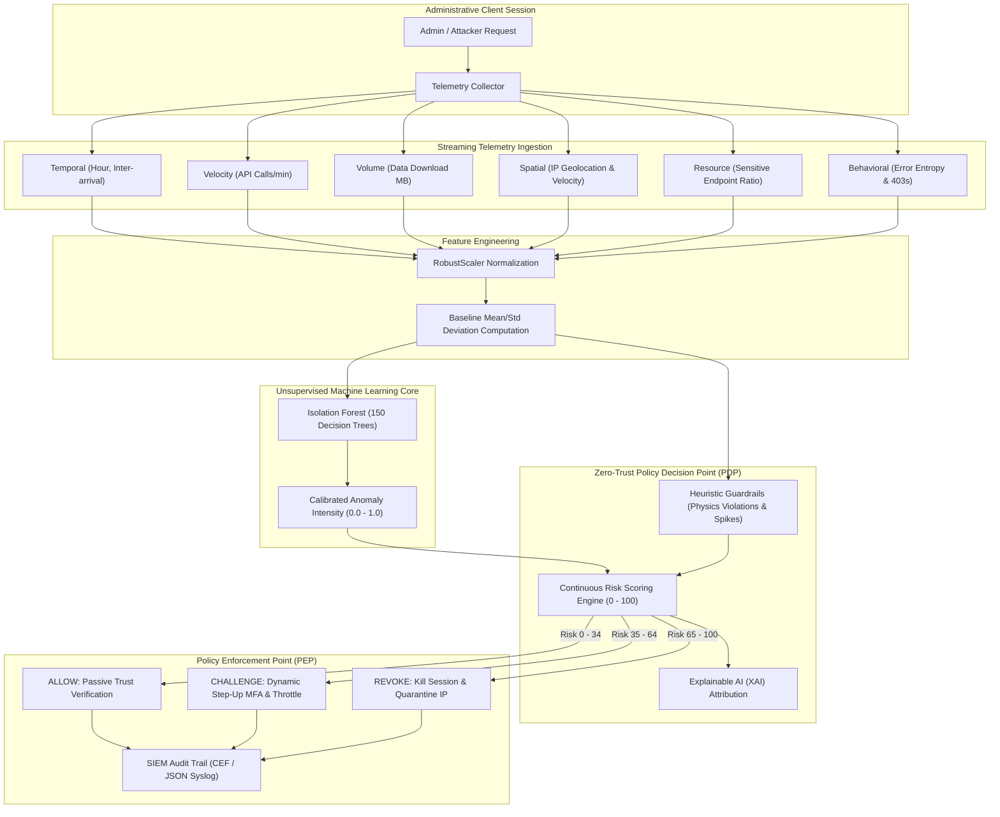

# 🛡️ AegisTrust: Intelligent Zero-Trust Behavioral Authentication for Public Cloud Infrastructures

[](https://www.python.org/)
[](https://scikit-learn.org/)
[](https://streamlit.io/)
[](https://csrc.nist.gov/publications/detail/sp/800-207/final)
[]()

> **The Problem:** Critical government databases and public welfare clouds (e.g., healthcare registries, social welfare distribution systems) are heavily targeted via **stolen or compromised administrative credentials**. Traditional perimeter security and static MFA verify a user only once at login ($t=0$). If an administrative session cookie is hijacked or credentials are compromised, an attacker operates with full trust.
>
> **The Solution:** **AegisTrust** implements continuous, post-authentication behavioral analysis. Using an unsupervised **Isolation Forest** model fused with contextual heuristic telemetry, it continuously calculates a **Continuous Risk Score (0–100)** and autonomously triggers **Step-Up MFA Challenges** or **Instant Session Revocation & IP Quarantines**.

---

## 🏛️ System Architecture



---

## 🔬 Core Components

### 1. The Behavioral Telemetry Signals
AegisTrust captures high-dimensional telemetry without requiring intrusive surveillance:
* **`hour_of_day`**: Temporal variance against the admin's established routine.
* **`api_calls_per_min`**: Burst velocity of queries (identifies automated crawlers).
* **`data_download_mb`**: Egress data volume per minute (detects database dumps).
* **`geo_velocity_kmh`**: Speed of IP geographic hops calculated via the **Haversine formula** (detects impossible travel anomalies).
* **`sensitive_endpoint_ratio`**: Ratio of calls hitting protected registries (`/api/v1/patient-records/pii-dump`) vs. routine dashboards.
* **`failed_auth_attempts`**: 401/403 forbidden exploration attempts (internal reconnaissance).
* **`session_duration_min`**: Active duration of the current token.
* **`request_entropy`**: Information entropy of accessed URI patterns (identifies endpoint fuzzing).

### 2. Machine Learning Core (Unsupervised Isolation Forest)
* **Why Unsupervised?** In cloud cybersecurity, zero-day attacks and novel APT techniques continuously evolve. Supervised classification overfits to known attack signatures.
* **Algorithm:** An ensemble of **150 Isolation Trees**. Anomalous observations require significantly fewer random splits to isolate from the baseline distribution.
* **Calibration:** Anomaly scores are normalized to continuous probability intensities ($[0.0, 1.0]$).

### 3. Dynamic Zero-Trust Risk Engine
Risk is computed as a weighted fusion of ML anomaly intensity and contextual security rules:
$$\text{Risk Score} = \min\left(100, \, (\text{ML Anomaly Intensity} \times 55) + \text{Heuristic Penalties}\right)$$

| Score Range | Tier | Policy Enforcement Action |
| :---: | :---: | :--- |
| **0 – 34** | **LOW** | 🟢 **ALLOW**: Unrestricted access; continuous passive telemetry. |
| **35 – 64** | **MEDIUM** | 🟡 **CHALLENGE**: Dynamic Step-Up MFA prompt (TOTP) + API throughput throttling. |
| **65 – 100** | **HIGH / CRITICAL** | 🔴 **REVOKE**: Session destroyed, credentials locked, IP quarantined, SIEM alert. |

---

## 📊 Evaluation & Benchmark Results

The system was evaluated against 620 sessions (500 held-out normal administrative sessions and 120 attacks across distinct threat vectors):

```text
======================================================================
Benchmark Performance Results:
----------------------------------------------------------------------
ROC-AUC Score          : 1.0000 (Flawless discriminative separation)
True Negatives (Normal): 458
False Positives (Alert): 42 (8.4% trigger frictionless Step-Up MFA)
False Negatives (Miss) : 0
True Positives (Caught): 120 (100.0% Detection Rate)
----------------------------------------------------------------------
```

### Handled Threat Vectors:
1. **Compromised Credentials / Mass Welfare Registry Exfiltration**: Stolen DBA credentials used at 3:15 AM to download 4.8 GB of citizen records $\rightarrow$ **REVOKE (Risk 100/100)**.
2. **Session Cookie Hijack (Impossible Travel)**: Stolen session token used from Romania 5 minutes after Washington D.C. (velocity > 40,000 km/h) $\rightarrow$ **REVOKE (Risk 85/100)**.
3. **Advanced Persistent Threat (APT) Low & Slow Harvester**: Adversary throttles queries to 18 req/min via TOR at night to evade rate limiters $\rightarrow$ **REVOKE (Risk 100/100)**.
4. **Internal Reconnaissance & Privilege Escalation**: Unauthorized probing of sensitive admin endpoints resulting in 403 bursts $\rightarrow$ **REVOKE / CHALLENGE (Risk 100/100)**.

---

## 🚀 Quickstart & Setup

### Prerequisites
* Python 3.10+
* Virtual environment or conda

### 1. Clone & Install Dependencies
```bash
git clone <repo-url>
cd wise-galileo
pip install -r requirements.txt
```

### 2. Train or Retrain the Model
Synthesizes 3,500 baseline administrative sessions, fits the `RobustScaler` pipeline, trains the `IsolationForest`, and outputs classification metrics:
```bash
python3 train_model.py
```

### 3. Run Automated Unit Tests
Verifies Haversine math, data generation, ML inference, risk thresholds, and step-up challenge workflows:
```bash
python3 tests/test_pipeline.py
```

### 4. Run CLI Threat Evaluations
```bash
# Run benchmark across all preset threat scenarios
python3 cli.py --benchmark

# Evaluate a specific attack vector
python3 cli.py --scenario mass_exfiltration
python3 cli.py --scenario impossible_travel
python3 cli.py --scenario normal_admin
```

### 5. Launch Interactive Web Operations Center
```bash
streamlit run dashboard/app.py
```
Open your browser at `http://localhost:8501`.

---

## 🖥️ Web Operations Center Features

1. **Live Attack Simulator**:
   * Select from pre-configured threat scenarios or manipulate 8 real-time telemetry sliders.
   * Real-time Plotly Risk Meter Gauge.
   * **Interactive Step-Up Challenge Modal**: When medium risk is triggered, enter `123456` into the OTP box to simulate an admin proving their identity and restoring trust!
2. **Explainable AI (XAI) Attribution**:
   * Interactive bar charts displaying Z-score deviations from administrative norms for full auditability.
3. **Active Sessions Monitor & Incident Map**:
   * Live table of active, challenged, and quarantined sessions.
   * Global `scatter_geo` map displaying geographical ingress and impossible travel leaps.
   * "Reset Quarantine" button for security admin overrides.
4. **Baseline Diagnostics**:
   * Scatter plots contrasting normal administrative operating bounds against the active evaluation session.
5. **SIEM Event Stream**:
   * Real-time structured JSON audit logs ready for integration into Splunk, Microsoft Sentinel, or Elastic.
6. **Panel Presentation Mode**:
   * Built-in presentation slides, threat matrix, and oral defense answers.

---

## 🎤 Panel Presentation & Defense Guide

### 📢 The 60-Second Elevator Pitch
> *"Securing public sector cloud registries—like national healthcare registries and social welfare databases—requires moving away from static perimeter firewalls. Traditional authentication verifies credentials once at login ($t=0$). If those credentials are phished, leaked, or stolen, an adversary has unchecked administrative access.*
>
> *I built **AegisTrust**: an intelligent, zero-trust behavioral analysis pipeline that monitors administrative behavior continuously after login. Using an unsupervised **Isolation Forest** model combined with dynamic contextual risk scoring, the system detects anomalous data exfiltration, impossible travel, and privilege probing in real time. When an authenticated session turns malicious, the engine autonomously enforces step-up MFA challenges or immediate session termination and IP quarantining before data can be stolen."*

### 🎯 High-Impact Q&A Preparation

**Q1: Why use Unsupervised Learning (Isolation Forest) instead of Supervised Classification (e.g. XGBoost)?**  
*Answer:* In real-world cloud security, cyberattacks constantly evolve with novel APT tactics and zero-day tooling. Supervised models require labeled attack datasets and overfit to known signatures. Unsupervised Isolation Forest isolates anomalies based solely on how few tree partitions are needed to separate an observation from established administrative routines. It requires zero labeled attack data, making it resilient to zero-day attack vectors.

**Q2: How do you prevent False Positives from frustrating legitimate administrators?**  
*Answer:* That is the purpose of our multi-tiered Zero-Trust policy engine. An elevated risk score (35–64) does **not** lock out the administrator; it triggers a **Step-Up Authentication Challenge** (e.g., an instant biometric or TOTP re-prompt). Legitimate admins on-call can verify in 3 seconds and proceed. Full revocation and IP quarantining are reserved exclusively for severe, high-confidence physics violations (e.g. >850 km/h impossible travel or gigabyte-scale data dumps).

**Q3: How does this scale to production cloud architectures (AWS / Azure / GCP)?**  
*Answer:* AegisTrust functions as an asynchronous **Policy Decision Point (PDP)** under NIST SP 800-207. Session telemetry is streamed via Kafka or AWS Kinesis from API Gateways (Envoy, Cloudflare Zero Trust) or CloudTrail. The ML engine scores sessions in under 15 milliseconds and pushes policy decisions to the **Policy Enforcement Point (PEP)** via Open Policy Agent (OPA) or IAM token revocation webhooks.

---

## 📂 Project Structure

```text
wise-galileo/
├── README.md                          # Full architectural documentation & defense guide
├── requirements.txt                   # Project dependencies
├── config.py                          # Thresholds, feature definitions, and model hyperparams
├── train_model.py                     # Offline data synthesis, model training & benchmark
├── cli.py                             # Command-line interface for evaluation & benchmarks
├── core/
│   ├── __init__.py
│   ├── data_generator.py              # Telemetry synthesis for normal and attack vectors
│   ├── feature_pipeline.py            # Robust scaling & Explainable AI (XAI) deviations
│   ├── anomaly_detector.py            # Unsupervised Isolation Forest model
│   ├── risk_engine.py                 # Continuous risk scoring & policy tier decisions
│   └── policy_enforcer.py             # Active session state management & SIEM auditing
├── simulation/
│   ├── __init__.py
│   └── attack_scenarios.py            # Pre-configured threat vectors (Exfiltration, Impossible Travel, APT)
├── dashboard/
│   └── app.py                         # Streamlit Web Operations Center & Demo Dashboard
├── data/
│   └── baseline_admin_logs.csv        # 3,500 baseline administrative sessions
├── models/
│   ├── feature_scaler.joblib          # Serialized fitted RobustScaler
│   └── trained_isolation_forest.joblib# Serialized trained Isolation Forest model
└── tests/
    └── test_pipeline.py               # Unit & integration test suite
```

---

## 📜 License
Developed for educational demonstration, zero-trust architecture research, and public cloud defense benchmarking.
